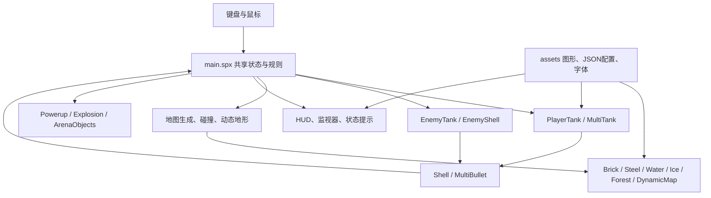
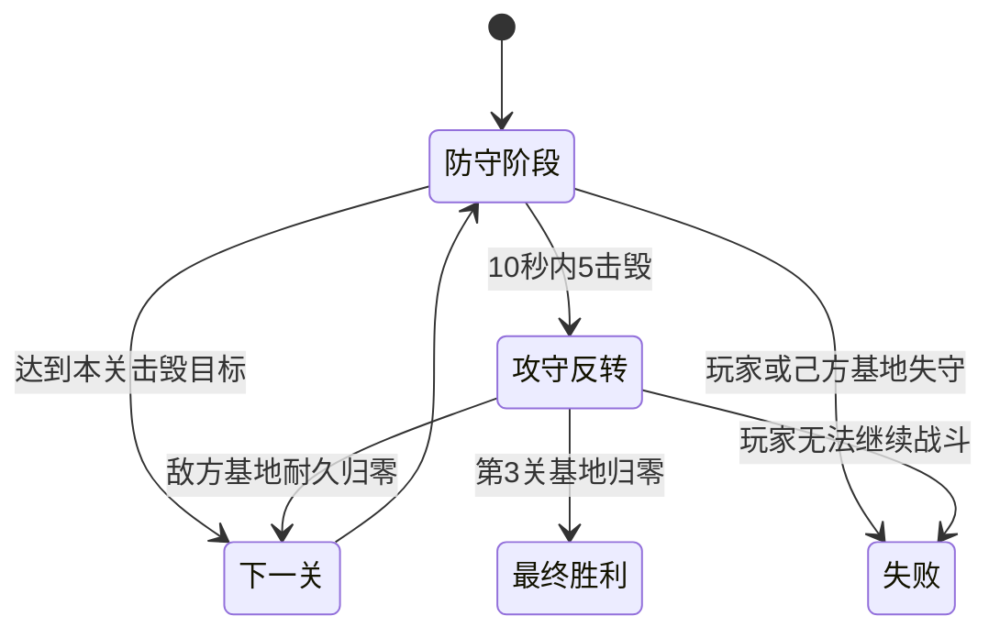

# 坦克大战：当前版本架构设计与功能说明

- 文档日期：2026-10-26
- 项目目录：`tanktank-local/`
- 技术栈：XGo / SPX v3
- 运行入口：`bash local.sh run`
- 运行尺寸：480 × 360；项目工作区域为 480 × 520
- 同步状态：本文档与本地当前源码同步，推送后作为 GitHub 仓库的版本说明

## 1. 产品概述

这是一个基于 XGo/SPX 精灵机制实现的俯视角坦克射击游戏。核心玩法包括移动、射击、地形阻挡、基地防守、敌军 AI、道具强化，以及满足条件后的攻守反转。

项目支持同一台设备上的本地多人，不包含网络联机：

- 单人三关：防守己方基地，击毁指定数量的敌军，或通过连击触发攻守反转后摧毁敌方基地。
- 双人合作：两名玩家共同防守基地，倒地后可由队友救援，并完成三关流程。
- 双人能源竞技：两名玩家争夺能源、攻击对方基地并按击杀和能源计分。
- 森林大围剿：单人或双人抵抗 50 辆敌军，也可以在双人局中直接击毁对手。
- 单人地图编辑器：在本轮运行中绘制砖墙、钢墙、水域和森林并试玩。

## 2. 运行区域与坐标

坐标原点位于舞台中心，x 向右增加，y 向上增加。游戏显示区域为 480 × 360，状态信息和监视器位于项目工作区域的上下边缘。

| 项目 | 当前配置 |
| --- | --- |
| 战场背景 | 480 × 360 |
| 坦克移动边界 | x ∈ [-216, 216]，y ∈ [-156, 156] |
| 坦克显示尺寸 | 约 20 × 20 px |
| 砖墙、钢墙、水域、森林 | 主要按 24 × 24 px 地形单元处理 |
| 地图编辑器 | 13 列 × 6 行，共 78 个位置，间距 32 px |
| 静态砖墙槽位 | 30 个，其中前 14 个用于普通砖墙，后 16 个用于基地墙/备用槽位 |
| 敌军槽位 | 4 个，可循环出生和补充 |
| 多人槽位 | 16 个固定槽位，当前主要使用 0 和 8 两个玩家槽位 |

显示缩放由各精灵的 `setSize` 控制。碰撞由 `main.spx` 的共享函数处理，炮弹使用分步推进来降低高速移动穿过障碍的概率。

## 3. 操作与功能

### 3.1 模式入口

| 按键 | 功能 |
| --- | --- |
| `N` | 开始或重置单人三关 |
| `J` | 开始或重置双人合作 |
| `K` | 开始或重置双人能源竞技 |
| `L` | 开始森林大围剿 |
| `Z` | 将下一局围剿设置为单人 |
| `X` | 将下一局围剿设置为双人 |
| `E` | 单人模式进入地图编辑器 |

| 场景 | 移动 | 射击 |
| --- | --- | --- |
| 单人 | 方向键 | 空格 |
| P1 | W/A/S/D | 空格 |
| P2 | 方向键 | Enter |

### 3.2 单人三关

单人初始生命为 3。普通阶段需要保护底部基地并击毁指定数量的敌军：

| 关卡 | 防守击毁目标 | 同时出现的敌军上限 | 主要地形与敌军 |
| --- | ---: | ---: | --- |
| 1 | 8 | 2 | 训练布局、砖墙、少量钢墙与森林 |
| 2 | 15 | 3 | 水域、钢墙、较快敌军 |
| 3 | 20 | 4 | 水域、钢墙、冰域、装甲或精英敌军 |

达到击毁目标会结束当前关卡。若在 10 秒内击毁 5 辆敌军，则会触发攻守反转；反转条件与普通目标同时满足时，当前实现优先按击毁目标过关。普通阶段基地被敌军炮弹击中、或玩家生命归零时失败。

### 3.3 攻守反转

攻守反转仅适用于单人和双人合作：

1. 清理旧炮弹和动态地图状态，切换为反转地图。
2. 底部己方基地墙退出战斗，地图上方出现敌方基地。
3. 敌方基地耐久按关卡为 6、8、10。
4. 玩家保留生命和火力升级；系统清理玩家附近可能造成卡死的障碍。
5. 玩家炮弹可以伤害敌方基地，敌军炮弹不会直接击毁敌方基地。
6. 敌方基地耐久归零后进入下一关；第三关完成后最终胜利。

### 3.4 双人合作

- 两名玩家各有 3 点生命，共享 5 点基地生命。
- 玩家之间可以推挤；友军炮弹碰到队友会消失，不造成伤害。
- 玩家倒地后进入约 10 秒救援窗口。
- 存活队友靠近倒地玩家并连续停留约 3 秒即可救援，离开范围会清空进度。
- 救援成功后恢复 3 点生命，并获得短暂保护。
- 两人均无法继续战斗，或共享基地生命耗尽时合作失败。

### 3.5 双人能源竞技

- 两名玩家各有一辆坦克和一座 5 点耐久基地，没有 AI 敌军。
- 摧毁对方基地立即获胜。
- 比赛时长为 3 分钟；击杀计 3 分，拾取中央能源计 1 分。
- 时间结束后比较总分，同分为平局。
- 被击毁的坦克约 2 秒后在安全位置复活，出生时短暂无敌。
- 能源约每 5 秒重新出现，拾取会增加分数并提升拾取者火力，最高 3 级。

### 3.6 森林大围剿

- `Z` 选择单人、`X` 选择双人，再按 `L` 开始。
- 没有基地、复活和救援；玩家各有 3 点生命。
- 敌军从上下左右边缘的安全位置随机进入，最多累计出场 50 辆。
- 同时出现上限随时间从 2 辆增加到 4 辆，敌军增援间隔逐渐缩短。
- 森林会遮挡坦克外观，并使敌军减少对被遮挡玩家的追击判断。
- 单人击毁全部 50 辆获胜；双人可共同击毁全部敌军，也可直接击毁对方获胜。

### 3.7 道具

普通关卡击毁敌军后按默认 40% 概率掉落道具，道具约 20 秒后过期，玩家接触后自动使用。

| 道具 | 效果 |
| --- | --- |
| 星星 | 火力等级 +1，最高 3 级 |
| 手雷 | 清除当前敌军，合作模式为共享清场 |
| 铁锹 | 基地墙临时变为钢墙，约 15 秒 |
| 头盔 | 玩家短暂无敌，约 8 秒 |
| 定时器 | 冻结敌军，约 6 秒 |
| 坦克 | 单人生命 +1；合作模式恢复拾取者生命并修复 1 点基地生命 |
| 钟表 | 敌军减速，约 10 秒 |

### 3.8 地形与动态地图

| 地形 | 坦克行为 | 炮弹行为 |
| --- | --- | --- |
| 砖墙 | 阻挡 | 可被击毁 |
| 钢墙 | 阻挡 | 阻挡，不可被普通炮弹击毁 |
| 水域 | 阻挡坦克 | 炮弹可穿过 |
| 冰域 | 可进入并产生加速、滑行 | 炮弹可穿过 |
| 森林 | 可进入并遮挡坦克 | 炮弹可穿过 |
| 燃烧森林 | 临时阻挡 | 临时阻挡 |
| 传送门 | 成对传送坦克 | 不改变炮弹路径 |

动态地图仅用于内置单人和合作流程，自建地图、能源竞技和森林围剿关闭自动变化。当前动态事件包括砖墙恢复、水域扩张、森林起火、冰域扩张和成对传送门；事件通常先预警，再在落点安全时生效。

### 3.9 地图编辑器

单人模式按 `E` 进入编辑器：

- `1`：砖墙
- `2`：钢墙
- `3`：水域
- `4`：森林
- `5`：擦除
- `R`：清空
- 鼠标点击或拖动：放置地形
- `Enter`：退出编辑并试玩自建地图

地图仅保存在本轮运行内存中，没有地图文件保存、地图列表或联网分享功能。自建地图不执行内置动态地形变化。

## 4. 软件架构

本项目是“共享舞台状态 + 精灵事件”的单体游戏架构，不是前后端服务架构。`main.spx` 保存规则和共享数组，各精灵通过共享变量、`onStart`、`onKey`、`onMsg` 和广播消息协作；`assets/` 保存图形、字体和运行配置。



### 4.1 文件职责

| 文件 | 职责 |
| --- | --- |
| `main.spx` | 模式切换、共享变量、地图生成、碰撞、道具、多人规则、反转和动态调度 |
| `PlayerTank.spx` | 单人坦克输入、朝向、移动、冰面滑行和开火 |
| `Shell.spx` | 单人炮弹运动、障碍/敌人/基地命中 |
| `EnemyTank.spx` | 4 个 AI 槽位的出生、移动、血量、射击、掉落和围剿巡逻 |
| `EnemyShell.spx` | 敌军炮弹运动、障碍检测和玩家伤害 |
| `MultiTank.spx` | 多人坦克槽位的显示和朝向 |
| `MultiBullet.spx` | 多人炮弹槽位的显示；命中规则由 `main.spx` 处理 |
| `MultiMarker.spx` | 护盾、火力强化、救援等前景标记 |
| `Battlefield.spx` | 背景和关卡外观切换 |
| `ArenaObjects.spx` | 能源、竞技基地和反转基地显示 |
| `Brick.spx` / `Steel.spx` | 砖墙与钢墙克隆、显示和位置同步 |
| `Water.spx` / `Ice.spx` / `Forest.spx` | 水域、冰域、森林显示 |
| `DynamicMap.spx` | 动态地形实体显示与刷新 |
| `Powerup.spx` | 掉落物克隆、拾取、过期和销毁 |
| `EditorTile.spx` | 编辑网格和鼠标摆放交互 |
| `HUD.spx` | HUD 背景定位和缩放 |
| `Explosion.spx` | 爆炸动画显示 |
| `assets/index.json` | 运行尺寸、精灵层级、监视器和字体配置 |
| `assets/sprites/*/index.json` | 各精灵造型及资源元数据 |
| `builder-meta.json` | XBuilder 项目名称、描述和操作提示 |
| `local.sh` | 设置本地 XGo、缓存和运行环境，提供 build/run/editor 入口 |

### 4.2 模式和状态

| `gameMode` | 含义 |
| ---: | --- |
| 0 | 单人三关 |
| 1 | 双人合作 |
| 2 | 双人能源竞技 |
| 3 | 保留的旧小队对轰实现，当前键盘没有入口 |
| 4 | 森林大围剿 |

| `gameState` | 含义 |
| ---: | --- |
| 0 | 失败或停止战斗 |
| 1 | 战斗运行中 |
| 2 | 胜负已结算 |
| 3 | 关卡切换中 |
| 4 | 模式初始化或地图编辑 |

单人和合作的核心流程如下：



### 4.3 数据组织

当前使用固定容量的平行数组，精灵克隆通过槽位下标访问数据：

- `brickX/Y`、`brickDestroyed`：砖墙位置和销毁状态。
- `steelX/Y`、`waterX/Y`、`iceX/Y`、`forestX/Y`：静态地形位置。
- `dynamicKind`、`dynamicX/Y`、`dynamicApplied`：动态地形、预警和到期状态。
- `enemyAlive`、`enemyPosX/Y`、`enemyHealth`：4 个敌军槽位。
- `multiUsed`、`multiX/Y`、`multiHP`、`multiDir` 等：多人坦克和炮弹槽位。
- `editorTiles`、`editorBroken`：78 个地图编辑位置。
- `lootX/Y`、`lootUntil`：掉落物保留位置和过期时间。

固定容量是当前实现的槽位上限，不代表实际每局全部出现。隐藏地形通常移动到远离战场的坐标，砖墙则同时维护销毁标记。

### 4.4 更新与消息

- `powerTick` 约每 0.1 秒增加一次，管理单人规则、道具时效、敌军出生和动态地图。
- `multiTick` 约每 0.05 秒增加一次，管理多人输入、炮弹、救援、能源和比赛时间。
- AI、炮弹、地形显示和 HUD 各自运行短间隔循环。
- 主要广播消息包括 `levelSetup`、`levelStart`、`levelClear`、`nextLevel`、`reversal`、`enemyHit`、`chestDrop`、`grenade`、`explode`、`win` 和 `lose`。

这套实现使用定时循环与键盘事件，不应理解为统一固定帧率的连续物理模拟。

## 5. 地图、碰撞与安全策略

### 5.1 地图生成

内置地图由 `randomizeMap()` 根据关卡选择固定主题地形，再填充砖墙和森林，并通过 `enrichMap()` 增加混合地形。生成时保留玩家出生点、敌军出生点和通往地图中心的通路。

自建地图由 `prepareCustomMap()` 清空内置地形，碰撞直接读取编辑器的 78 个位置；竞技和围剿模式则使用各自的静态布置。

### 5.2 关键碰撞函数

- `tankBlocked()`：检查边界、砖墙、钢墙、水域、动态燃烧区域和基地。
- `obstacleAt()`：检查炮弹或实体障碍，正数代表可破坏砖块，负数代表不可破坏障碍。
- `enemyAt()` / `multiAt()`：按槽位和半径查找敌军或玩家。
- `dynamicPlacementSafe()`：动态地形落点避开玩家、敌军、掉落物、已有地形和保留通路。
- `spawnIsSafe()`：敌军出生点检查；没有安全落点时延迟重试。
- `accessLane()` / `reserveAccessLanes()`：为内置地图保留纵向和横向通路。

## 6. 资源、构建与版本边界

根目录资源包括：

- `assets/index.json`：运行区域、图层顺序、监视器和字体配置。
- `assets/sprites/`：背景、坦克、炮弹、地形、道具、HUD 和特效资源。
- `assets/fonts/basic-chinese/`：中文字体资源。
- `builder-meta.json`：项目展示名称和操作说明。
- `go.mod` / `go.sum`：SPX v3 运行依赖。
- `local.sh`：本地工具链和运行入口。

本地常用命令：

```sh
bash local.sh build
bash local.sh run
bash local.sh editor
```

`.temp/`、`project/`、`.godot-user/` 和其他运行时生成目录由 `.gitignore` 排除，不属于源码发布内容。项目当前是本地多人，不包含网络同步、地图持久化、录像回放或自动存档。

## 7. 验证建议

发布前建议至少检查：

1. `bash local.sh build` 能够完成构建。
2. `N` 可完成三关普通流程、反转流程和失败流程。
3. `J` 可完成救援、共享基地和合作反转流程。
4. `K` 可验证能源刷新、基地伤害、复活和 3 分钟结算。
5. `Z/X/L` 可验证森林遮挡、50 辆敌军预算和双人胜负。
6. `E` 可放置、擦除、清空并试玩自建地图。
7. GitHub 仓库中的资源路径与本地 `assets/` 结构一致。

当前文档描述源码和规则，不替代画面、键盘手感、不同机器帧率和实际部署环境的验收。
